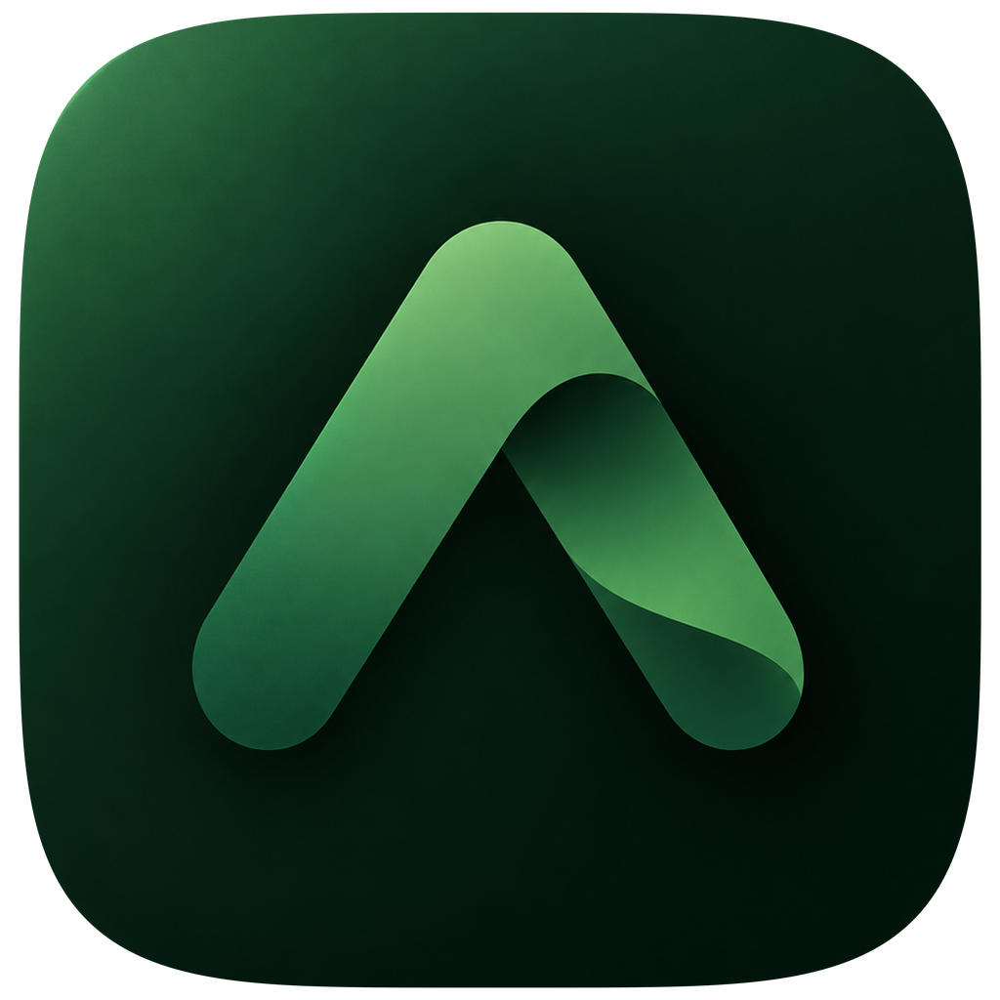
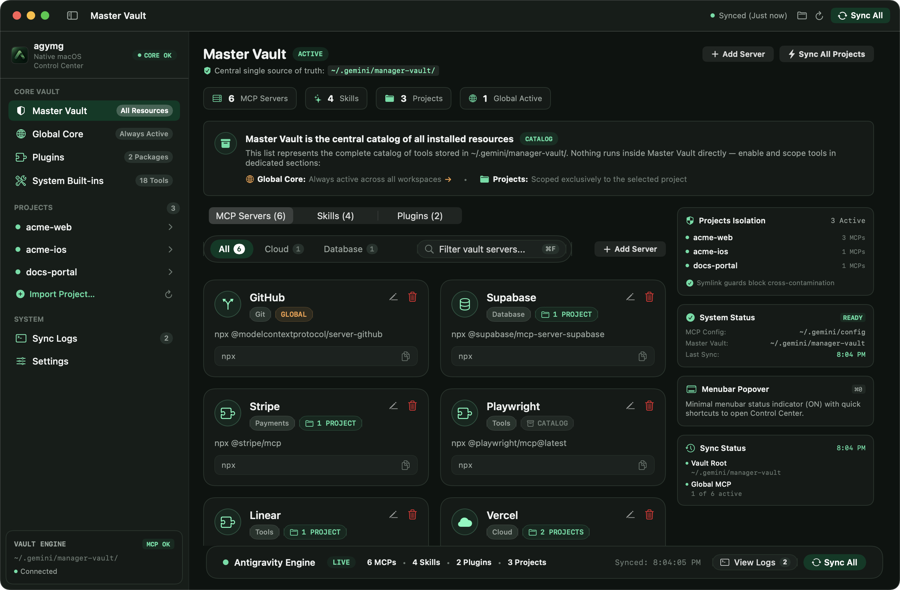
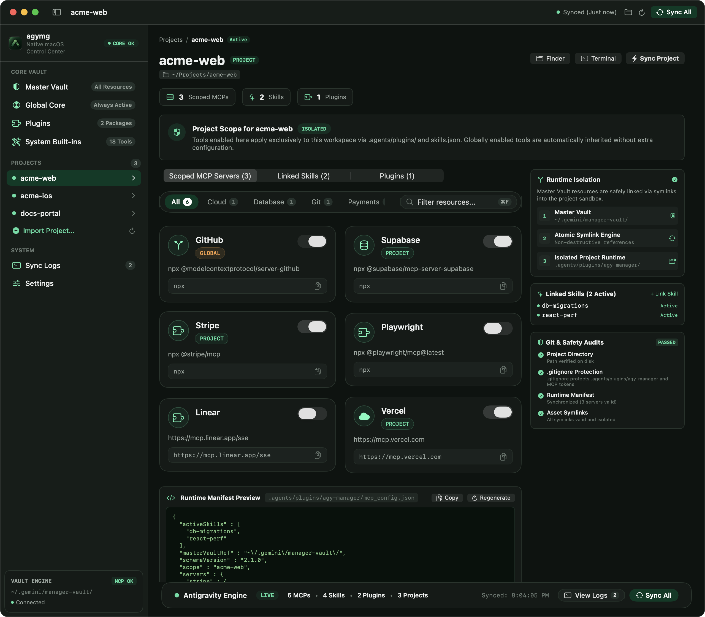
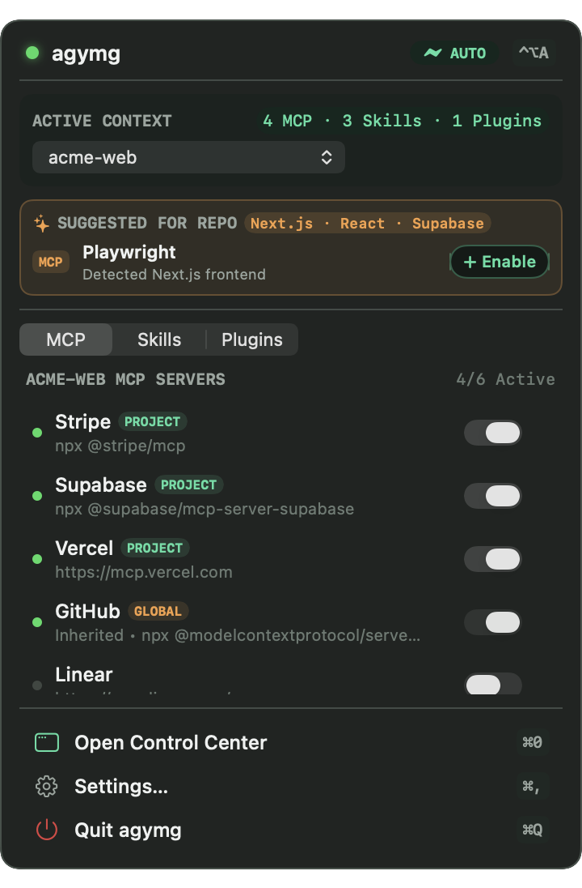

<div align="center">



# agymg

**Unified MCP, Skills & Plugins Control Center for Claude Code & Antigravity on macOS**

[](https://www.apple.com/macos/)
[](https://www.swift.org/)
[](#architecture)
[](LICENSE)

Define your MCP servers, skills, and plugins **once** in a local Master Vault—then toggle them globally or scope them per repository across **both** **Claude Code** and **Antigravity** in one click.

[Quick Install](#quick-install) • [Under the Hood Example](#minimal-example-sharing-1-mcp-server--1-skill-under-the-hood) • [Features](#features) • [Headless CLI](#headless-cli--sessionstart-radar) • [Contributing](CONTRIBUTING.md)

</div>

---

<p align="center">
  
</p>

<table>
  <tr>
    <td width="64%" valign="top">
      
      <p align="center"><sub><b>Per-Project Isolation</b> — Scoped MCP manifests, POSIX skill symlinks, and live <code>.gitignore</code> safety audits.</sub></p>
    </td>
    <td width="36%" valign="top">
      
      <p align="center"><sub><b>Menubar Popover (<code>⌃⌥A</code>)</b> — Instant toggles and stack-aware recommendations.</sub></p>
    </td>
  </tr>
</table>

---

## Why `agymg`?

Running **Claude Code** alongside **Antigravity** on the same Mac quickly turns into configuration drift and context bloat:

1. **Global MCP Bloat**: Enabling 15 MCP servers globally injects hundreds of tool schemas into *every* agent conversation—burning tokens and exposing production APIs (Stripe, Supabase, cloud providers) inside unrelated repositories.
2. **Incompatible Config Layouts**:
   - **Antigravity** reads global servers from `~/.gemini/config/mcp_config.json` (`serverUrl`), ignores root `.agents/mcp_config.json`, and requires per-project MCP servers to be packaged as a local plugin inside `<repo>/.agents/plugins/<name>/`.
   - **Claude Code** stores user and per-project `mcpServers` inside `~/.claude.json` (`type: "http"`, `url`) and reads skills from `~/.claude/skills/` and `<repo>/.claude/skills/`.
3. **Duplicated Skills**: Maintaining two copies of `SKILL.md` folders across `.claude/skills` and `.agents/skills` guarantees they fall out of sync.

**`agymg` solves all three** with a zero-dependency native SwiftUI menubar app + headless CLI (`< 15 MB` RAM, zero Node/Electron background processes).

---

## Quick Install

> **Requirements**: macOS 14.0+ (Sonoma or Sequoia) and Xcode Command Line Tools (`xcode-select --install`).

### Option 1 — One-Command Install (Recommended)

Compiles a native release binary locally on your Mac and signs `agymg.app` ad-hoc—**zero `com.apple.quarantine` Gatekeeper popups** without needing a paid Apple Developer certificate:

```bash
curl -fsSL https://raw.githubusercontent.com/stankela16/agymg/main/Scripts/install.sh | bash
```

This installs `/Applications/agymg.app` and links the `agymg` CLI into `/opt/homebrew/bin/agymg` (or `/usr/local/bin` / `~/.local/bin`).

### Option 2 — Homebrew Tap

```bash
brew tap stankela16/tap
brew install agymg
agymg install-app
```

### Option 3 — Build from Source

```bash
git clone https://github.com/stankela16/agymg.git
cd agymg
./Scripts/install.sh
```

Launch `agymg` from Spotlight or `/Applications/agymg.app`. On first launch, choose your Projects folder (or skip and import individual repositories anytime with `⌘O`). Existing MCP servers and skills from `~/.claude.json`, `~/.claude/skills`, and `~/.gemini/config/` are imported into your Master Vault automatically—after taking a timestamped backup snapshot of your original configs.

---

## Minimal Example: Sharing 1 MCP Server & 1 Skill Under the Hood

Curious what `agymg` actually writes to disk—or want to wire up the same cross-agent pattern manually? Here is the exact layout for sharing **one scoped MCP server (`supabase`)** and **one skill (`react-perf`)** inside `~/Projects/acme-web`:

### 1. Single Source of Truth (`~/.gemini/manager-vault/`)

```text
~/.gemini/manager-vault/
├── master_mcp.json               # Canonical MCP definitions (stdio + remote HTTP/SSE)
└── skills/
    └── react-perf/
        └── SKILL.md              # Canonical skill instructions (authored once)
```

### 2. What `agymg` Generates for `~/Projects/acme-web`

```text
~/Projects/acme-web/
├── .gitignore                    # Auto-guarded so generated MCP secrets never get committed
├── .git/info/exclude             # Keeps symlinked .claude/skills entries out of `git status`
├── .agents/                      # ← Read by Antigravity
│   ├── skills/
│   │   └── react-perf -> ~/.gemini/manager-vault/skills/react-perf
│   └── plugins/
│       └── agy-manager/          # Local plugin wrapper required by Antigravity for per-repo MCP
│           ├── plugin.json
│           └── mcp_config.json
└── .claude/                      # ← Read by Claude Code
    └── skills/
        └── react-perf -> ~/.gemini/manager-vault/skills/react-perf
```

#### Antigravity Per-Project Plugin (`.agents/plugins/agy-manager/plugin.json` & `mcp_config.json`)

Antigravity only scopes MCP servers to a single repository when wrapped in a local `.agents/plugins/<name>/` bundle:

```json
// .agents/plugins/agy-manager/plugin.json
{
  "name": "agy-manager"
}
```

```json
// .agents/plugins/agy-manager/mcp_config.json
{
  "mcpServers": {
    "supabase": {
      "command": "npx",
      "args": ["-y", "@supabase/mcp-server-supabase"],
      "env": {
        "SUPABASE_ACCESS_TOKEN": "sbp_..."
      }
    }
  }
}
```

#### Claude Code Per-Project Scope (`~/.claude.json`)

Simultaneously, `agymg` updates the matching project entry inside `~/.claude.json` (preserving all unrelated Claude Code state, OAuth tokens, and history, and automatically translating remote `serverUrl` ↔ `{"type": "http", "url": "..."}`):

```json
{
  "projects": {
    "/Users/alex/Projects/acme-web": {
      "hasTrustDialogAccepted": true,
      "mcpServers": {
        "supabase": {
          "type": "stdio",
          "command": "npx",
          "args": ["-y", "@supabase/mcp-server-supabase"],
          "env": {
            "SUPABASE_ACCESS_TOKEN": "sbp_..."
          }
        }
      }
    }
  }
}
```

And because both `.agents/skills/react-perf` and `.claude/skills/react-perf` are **POSIX symlinks** pointing to `~/.gemini/manager-vault/skills/react-perf`, editing `SKILL.md` once updates both agents immediately.

---

## Features

- **Master Vault (`~/.gemini/manager-vault/`)**: One local catalog for all MCP servers (`stdio` commands + remote HTTP/SSE endpoints), `SKILL.md` packages, and plugins.
- **Zero-Config First-Run Bootstrap**: Automatically imports existing MCP servers and skills from both Claude Code (`~/.claude.json`, `~/.claude/skills/`) and Antigravity (`~/.gemini/config/mcp_config.json`, `~/.gemini/config/skills/`).
- **Global Core vs. Per-Project Isolation**: Keep universal tools (e.g., `github`) in **Global Core** while isolating domain-specific MCPs (`stripe`, `supabase`, `playwright`) to the repositories that actually need them.
- **Menubar Quick Popover & Global Hotkey (`⌃⌥A`)**: Detects your active IDE workspace automatically, surfaces stack-aware recommendations (`package.json`, `Package.swift`, `pyproject.toml`, `Cargo.toml`, `supabase/`), and lets you toggle tools without leaving your editor.
- **Git & Secret Safety Audits**: Automatically appends `.agents/plugins/agy-manager/` rules to `.gitignore` before writing scoped `mcp_config.json` files so API tokens are never accidentally staged in Git.
- **Live External Change Adoption**: Runs a lightweight 15-second reconciliation check so tools added via `claude mcp add`, `agy mcp`, or newly created skill folders are adopted back into your Vault seamlessly.
- **Automatic & Manual Config Backups**: Before `agymg` touches any external config file for the first time, it snapshots your existing `.claude.json` and `mcp_config.json` into `~/.gemini/manager-vault/backups/snapshot-<timestamp>/` (retaining up to 10 snapshots while always preserving your initial `pre-first-sync` backup, plus one-click manual backups in **Settings → Master Vault**).

---

## Headless CLI & `SessionStart` Radar

Every installation includes the `agymg` CLI for terminal workflows, scripts, and agent hooks:

```bash
# Compact workspace summary + smart Vault recommendations
agymg brief --project ~/Projects/acme-web

# Machine-readable JSON state for scripts or custom skills
agymg brief --project . --json

# Enable or disable Vault resources for a specific project (syncs manifests & symlinks immediately)
agymg set --project . --enable-mcp playwright --enable-skill react-perf

# Enable or disable Vault resources globally across all workspaces
agymg set --global --disable-mcp linear

# Copy agymg.app into /Applications (used after `brew install agymg`)
agymg install-app

# Print CLI version
agymg --version
```

### Optional: Proactive Claude Code `SessionStart` Hook

Want Claude Code to surface missing Vault tools automatically when you open a repository? Add `agymg hook-session-start --format claude-text` to `~/.claude/settings.json` (or `agymg hook-session-start --format antigravity` for Antigravity hooks):

```json
{
  "hooks": {
    "SessionStart": [
      {
        "hooks": [
          {
            "type": "command",
            "command": "agymg hook-session-start --format claude-text"
          }
        ]
      }
    ]
  }
}
```

---

## Keyboard Shortcuts

| Shortcut | Action |
| :--- | :--- |
| `⌃⌥A` | Open Control Center window globally from any app |
| `⌘0` | Open Control Center window |
| `⌘1` – `⌘5` | Jump to Master Vault, Global Core, Plugins, Built-ins, or Sync Logs |
| `⌘S` | Synchronize all global and project configurations to disk |
| `⌥⌘S` | Synchronize active workspace |
| `⌘R` | Reload system and workspace definitions from disk |
| `⇧⌘R` | Reveal `~/.gemini/manager-vault/` in Finder |
| `⌘N` | Create a new project workspace |
| `⌘O` | Import an existing project folder into `agymg` |
| `⌘F` | Filter servers, skills, or plugins |
| `⌘,` | Open Settings |

---

## Sandboxed / Custom Environment Variables

For multi-profile setups, CI, or isolated testing without touching `~/.gemini`:

| Variable | Description |
| :--- | :--- |
| `AGYMG_GEMINI_DIR` | Override the base `.gemini` directory (Vault is stored at `$AGYMG_GEMINI_DIR/manager-vault`). |
| `AGYMG_PROJECTS_DIR` | Override the default Projects workspace scan root. |

---

## Uninstall & Restore

1. Quit `agymg` (`⌘Q` from the menubar popover).
2. Remove the app and CLI symlink:
   ```bash
   rm -rf /Applications/agymg.app /opt/homebrew/bin/agymg
   ```
3. *(Optional)* Restore any pre-sync backup from `~/.gemini/manager-vault/backups/` before removing `~/.gemini/manager-vault/`.

---

## Architecture & Contributing

Built with **Swift 6** (`strict-concurrency=complete`), **SwiftUI**, and **AppKit** using Swift Package Manager—zero external dependencies.

- Read [AGENTS.md](AGENTS.md) for codebase layout and sync invariants.
- Read [CONTRIBUTING.md](CONTRIBUTING.md) for build, packaging, and test instructions (`swift test` runs 220+ sandboxed unit & integration tests).

## License

Released under the [MIT License](LICENSE). Copyright © 2026 Nikola Stanojevic.
